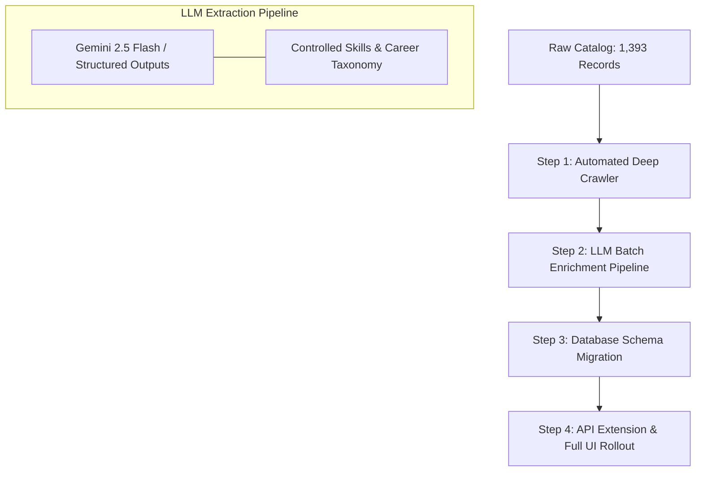

# V2 Catalog Enrichment — Architecture & Handoff Specification

## 1. Executive Summary

- **V1 Scope (Shipped)**: High-performance, searchable, filterable catalog containing all **1,393 Google Cloud credentials** (Hands-on Labs, Skill Courses, and Learning Paths) with full-text search (SQLite FTS5), duration brackets, difficulty levels, and direct Google Skills links.
- **V2 Scope (Upcoming)**: **Deep Catalog Enrichment**. The goal of V2 is to transform the index from a metadata search engine into an intelligent career advisory and skills-discovery platform by augmenting every record with AI-extracted technical skills, career paths, domain categorization, and syllabus insights.

All prototype code, samples, and extraction utilities for V2 have been isolated into [`v2_enrichment/`](file:///c:/Users/acer/Desktop/projects/credBase/v2_enrichment/) so that V1 remains lightweight and production-ready.

---

## 2. Enrichment Schema Specification

The prototype enrichment schema is structured as follows:

```json
{
  "id": "course_templates_783",
  "title": "Manage Kubernetes in Google Cloud",
  "type": "course",
  "level": "intermediate",
  "duration_minutes": 255,
  "url": "https://www.skills.google/course_templates/783",
  "description": "This course covers GKE deployment scaling, kubectl application debugging...",
  "enrichment": {
    "summary": "Skill badge course covering GKE deployment scaling, kubectl application debugging, and metric collection using Managed Prometheus.",
    "skills": [
      "Kubernetes",
      "GKE (Google Kubernetes Engine)",
      "kubectl",
      "Container Management",
      "Continuous Delivery",
      "Prometheus"
    ],
    "domains": [
      "Containerization & Orchestration",
      "Cloud DevOps"
    ],
    "career_paths": [
      "Kubernetes Engineer",
      "DevOps Engineer",
      "Cloud Infrastructure Engineer"
    ],
    "prerequisites": [
      "Basic Linux command line",
      "Google Cloud Fundamentals"
    ],
    "certification_alignment": [
      "Google Cloud Certified Associate Cloud Engineer",
      "Google Cloud Certified Professional Cloud DevOps Engineer"
    ]
  }
}
```

### Field Definitions

| Field | Type | Description |
| :--- | :--- | :--- |
| `summary` | `string` | 1–2 sentence high-impact summary focusing on practical learning outcomes. |
| `skills` | `list[string]` | Normalized specific technical tools and technologies (e.g. `Terraform`, `BigQuery`, `UNNEST`). |
| `domains` | `list[string]` | High-level industry subject areas (e.g. `Cybersecurity`, `AI/ML`, `DevOps & SRE`). |
| `career_paths` | `list[string]` | Industry job titles and career tracks for which this credential provides direct preparation. |
| `prerequisites` *(Planned)* | `list[string]` | Recommended prior knowledge or foundational courses. |
| `certification_alignment` *(Planned)* | `list[string]` | Official Google Cloud certifications to which this credential contributes. |

---

## 3. Prototype Assets in `v2_enrichment/`

| File | Purpose |
| :--- | :--- |
| [`v2_enrichment/enriched_10.json`](file:///c:/Users/acer/Desktop/projects/credBase/v2_enrichment/enriched_10.json) | Reference dataset of 10 fully-enriched records spanning AI, Security, Kubernetes, IaC, Data Analytics, and multi-cloud labs. |
| [`v2_enrichment/samples_10.json`](file:///c:/Users/acer/Desktop/projects/credBase/v2_enrichment/samples_10.json) | Raw sample records extracted from `credentials.db` for benchmarking. |
| [`v2_enrichment/select_10_samples.py`](file:///c:/Users/acer/Desktop/projects/credBase/v2_enrichment/select_10_samples.py) | Query script selecting a balanced sample across courses, labs, and learning paths. |
| [`v2_enrichment/enrich_10_samples.py`](file:///c:/Users/acer/Desktop/projects/credBase/v2_enrichment/enrich_10_samples.py) | Transformation script compiling the sample dataset into `enriched_10.json`. |
| [`v2_enrichment/extract_one.py`](file:///c:/Users/acer/Desktop/projects/credBase/v2_enrichment/extract_one.py) | Web scraping utility demonstrating deep HTML extraction of lab focus pages (syllabus steps, lab IDs, and detailed descriptions). |

---

## 4. UI Design Reference (Tested in Prototype)

In the V2 prototype, enrichment metadata was rendered in three UI locations:

1. **Card Preview**:
   - Highlighted card container with a subtle blue ring (`border-blue-300 ring-1 ring-blue-200/50`).
   - Pill badge: `✨ Curated`.
   - Top 3 skill badges rendered below the description.
2. **Detail Modal (`#modal-enrichment-section`)**:
   - Dedicated gradient card (`from-blue-50/60 to-indigo-50/40`) containing the AI summary.
   - Interactive badge collections:
     - Blue badges for **Key Skills Taught**.
     - Emerald badges for **Target Career Paths**.
3. **Filter Navigation**:
   - `✨ Curated Insights` toggle pill in trending tags bar.
   - Filter switch in the sidebar to view only enriched items (`?enriched=true`).

---

## 5. V2 Implementation Plan & Roadmap



### Step 1: Automated Deep Crawler
- Extend [`v2_enrichment/extract_one.py`](file:///c:/Users/acer/Desktop/projects/credBase/v2_enrichment/extract_one.py) to crawl the 1,393 courses and labs asynchronously using `httpx` or `aiohttp`.
- Cache HTML snapshots and extract full syllabus modules, lab code identifiers, and target audience text.

### Step 2: LLM Batch Enrichment Pipeline
- Run catalog records through Gemini Flash (via Google GenAI SDK) using structured output / Pydantic schema validation.
- Implement an explicit canonical skills dictionary (e.g. mapping `k8s` → `Kubernetes`, `gke` → `Google Kubernetes Engine`) to avoid taxonomy fragmentation.

### Step 3: Database Schema Migration
To maintain fast queries at scale, migrate from an external JSON lookup to SQLite relational tables:

```sql
-- Normalized skills table
CREATE TABLE skills (
    id INTEGER PRIMARY KEY AUTOINCREMENT,
    name TEXT UNIQUE NOT NULL
);

-- Normalized career paths table
CREATE TABLE career_paths (
    id INTEGER PRIMARY KEY AUTOINCREMENT,
    title TEXT UNIQUE NOT NULL
);

-- Join table: Credential <-> Skills
CREATE TABLE credential_skills (
    credential_id TEXT REFERENCES credentials(id),
    skill_id INTEGER REFERENCES skills(id),
    PRIMARY KEY (credential_id, skill_id)
);

-- Join table: Credential <-> Career Paths
CREATE TABLE credential_career_paths (
    credential_id TEXT REFERENCES credentials(id),
    career_path_id INTEGER REFERENCES career_paths(id),
    PRIMARY KEY (credential_id, career_path_id)
);

-- Credential summary and prerequisites
ALTER TABLE credentials ADD COLUMN ai_summary TEXT;
ALTER TABLE credentials ADD COLUMN prerequisites TEXT;
```

### Step 4: API & Frontend Rollout
- **API**:
  - `GET /api/skills` — Returns top skills with credential counts for autocomplete.
  - `GET /api/careers` — Returns career tracks with associated credentials.
  - Extend `GET /api/credentials` with `skills=Kubernetes,Terraform` and `career=DevOps+Engineer`.
- **Frontend**:
  - Multi-select skill filter pills.
  - Career Track visual roadmap (e.g. "Cloud Architect Track: Step 1 → Step 2 → Step 3").
